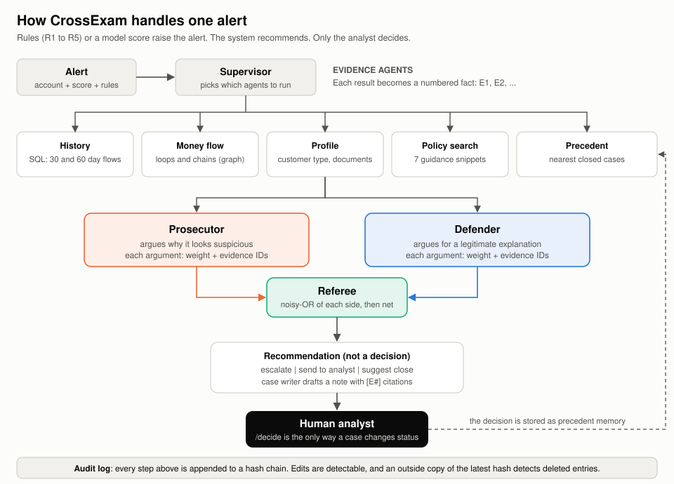
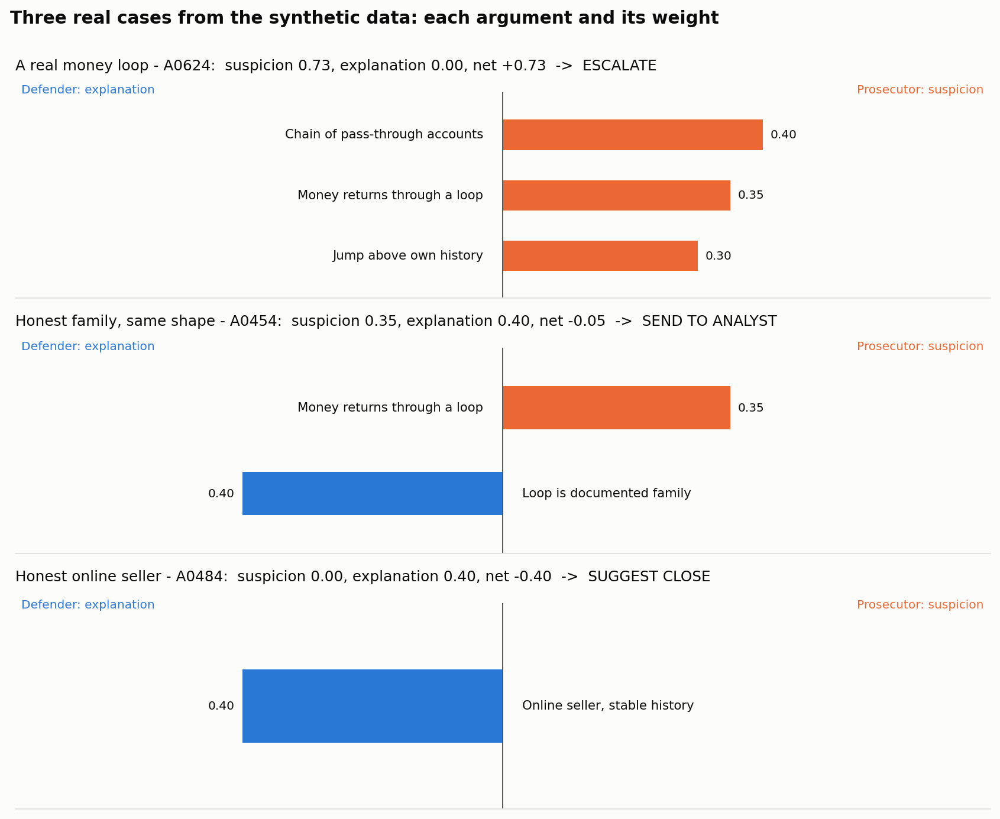
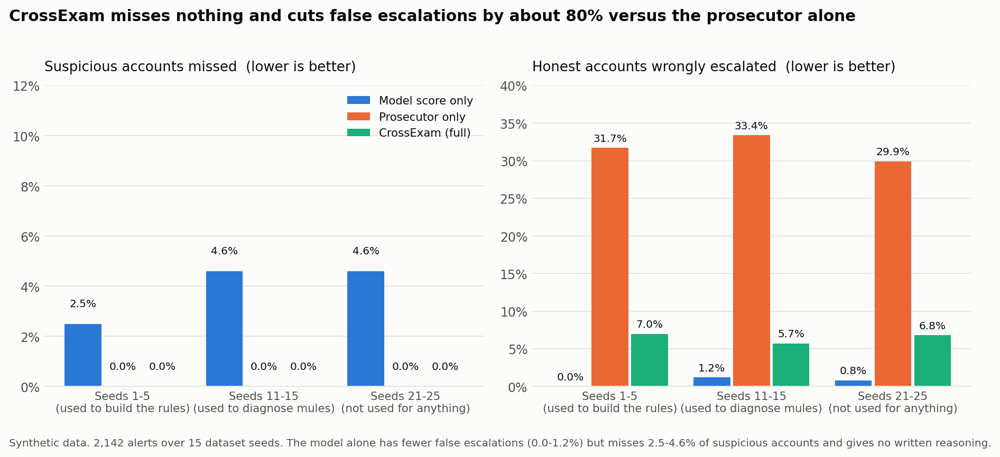
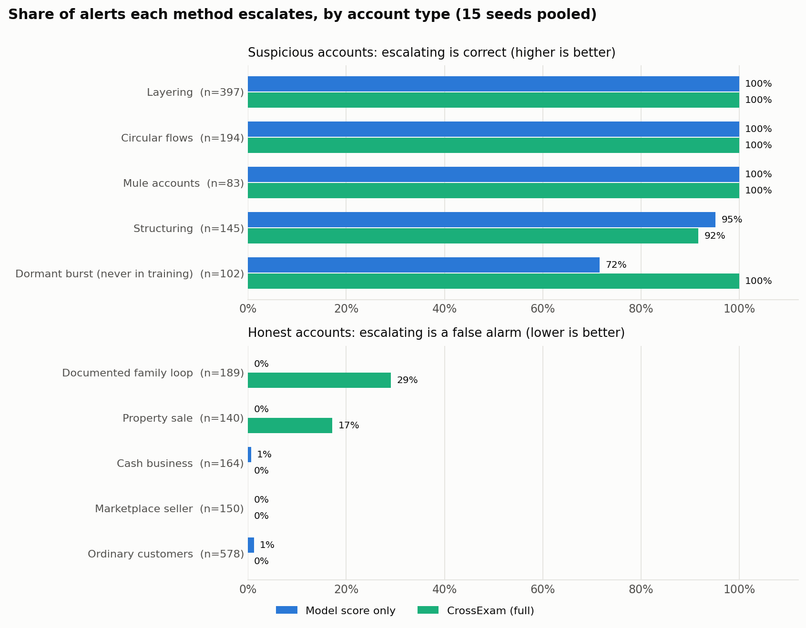

# CrossExam

A cross-examination workflow for anti-money-laundering alerts. For each alert, a prosecutor agent argues why it looks suspicious, a defender agent argues for a legitimate explanation, and a referee weighs both. A case note is written with every claim tied to evidence, and a human analyst always makes the final decision.

**All data is synthetic.** Nothing here uses real customer or bank data, and the results below say nothing about a real bank.



## How it works

1. A gradient-boosting model scores accounts using 30-day features. It is trained on four scheme types (structuring, layering, circular flows, mule accounts). A fifth type, dormant-account bursts, is held out of training.
2. Simple rules (R1 to R5) plus the model score decide which accounts raise an alert.
3. A LangGraph supervisor picks which sub-agents to run: history (SQL), graph (money flow), profile, policy search (TF-IDF over 7 guidance snippets) and precedent (nearest closed cases).
4. The prosecutor and defender each list weighted arguments that point to evidence IDs. Weights are combined with noisy-or. The referee recommends escalate, analyst review or suggest close.
5. The case writer produces a note with `[E#]` citations. `check_note` verifies that every tag exists, every number in the evidence list comes from the evidence, and the printed weights and referee scores match the arguments and verdict.
6. `/decide` is the only way a case changes status. Every step goes into a hash-chained audit log.

The data includes look-alike customers who are honest but resemble schemes (cash businesses, documented family loops, marketplace sellers, property sales).

**The 10,000 "reporting threshold" and the 9,000 to 9,999 band are stand-ins.** I searched for a Swedish rule that sets such a threshold and found none (see [docs/RESEARCH.md](docs/RESEARCH.md)). The 7 guidance snippets are my own paraphrases of general typology descriptions, not quotations from FATF or any regulator.

## What a case looks like

The three cases below come from real runs on the synthetic data. Orange bars are the prosecutor's arguments, blue bars the defender's, and each number is the argument's weight. The same loop of accounts is escalated when it is undocumented, sent to an analyst when the loop is documented family, and a plain online seller gets a suggested close.



The note the case writer produces for the first case (the full text is in [docs/sample_case_note.txt](docs/sample_case_note.txt)):

```
Case for suspicion:
- The money passed through a chain of accounts almost unchanged. (weight 0.40, guidance P2) [E5]
- Money returned to its source through a short loop of accounts. (weight 0.35, guidance P3) [E4]
- Inflows jumped far above the account's own history. (weight 0.30, guidance P5) [E3]
Case for a legitimate explanation:
- No supporting explanation found.

Referee: suspicion 0.73, explanation 0.00, net +0.73. Recommendation: escalate.
...
Status: awaiting analyst decision. This system does not close or escalate cases by itself.
```

## Run

```
pip install -r requirements.txt
python -m pytest -q
python -m crossexam.evaluate      # about 2 minutes, writes results.json
python -m crossexam.evaluate results_heldout.json 11 12 13 14 15   # other seeds
pip install matplotlib
python docs/make_figures.py       # redraws the figures in docs/ from the result files
uvicorn crossexam.api:app         # audit log is kept in crossexam_audit.db (set CROSSEXAM_AUDIT_DB to change)
```

### Docker

```
docker compose up --build         # API on http://127.0.0.1:8000, docs at /docs
```

The image runs as a non-root user and keeps the audit log in a named volume, so it survives restarts. The port is bound to this machine only because the API has no authentication. The container reports healthy about 25 seconds after start (the model is trained at startup).

### Neo4j export

```
python -m crossexam.cypher graph.cypher
```

This writes a constraint, one `:Account` node per account (including external counterparties) and one `:PAID` relationship per transaction that has two non-empty ends and a finite day and amount (any other row is skipped, because Cypher cannot express it). It was tested against Neo4j 5 in Docker: node and relationship counts match the SQLite source (`tests/test_neo4j_live.py`, about 2.5 minutes, skipped when Docker or the `neo4j:5` image is missing). An earlier version of this export wrote only 438 of 55,934 transactions, because it created nodes for customers only, and took almost 6 minutes; both problems are fixed.

## Results



### Seeds 1 to 5 (718 alerts, `results.json`)

| Method | Suspicious missed | False escalations | Sent to analyst |
|---|---|---|---|
| Model score only (escalate at 0.5) | 2.5% | 0.0% | 0% |
| Prosecutor only | 0.0% | 31.7% | 0% |
| CrossExam (full) | 0.0% | 7.0% | 31.6% |

What this shows, honestly:
- The model alone is strong on this synthetic data and has almost no false escalations, because the planted schemes are easy for it. CrossExam does **not** beat it on false escalations. Its extra value here is no missed cases, the held-out dormant type (model escalates 82.5%, CrossExam 100%), and written, cited reasoning.
- Hearing both sides cuts false escalations from 31.7% (prosecutor alone) to 7.0%. About a third of alerts go to analyst review instead of being forced into a yes or no.
- Precedent memory (second half of each queue, simulated analyst decisions taken from ground truth): false escalations drop from 16.3% to 2.3%, while misses stay at 0.0% and fewer suspicious accounts are escalated outright (98.7% to 95.3%, the rest go to review). It is a trade, not a free gain.
- Every generated note passed the citation check (718 of 718). The check proves the tags exist, the numbers in the evidence list come from the evidence text and the printed weights and scores match the arguments. It does not prove the reasoning is correct.

### By account type



These shares are pooled over all 15 seeds. The honest look-alikes are where CrossExam still raises false alarms: 29% of documented family loops and 17% of property sales are escalated instead of sent to an analyst (per seed group the range is 23% to 40% and 11% to 26%). The model alone does not escalate them, but it also gives no reasons and misses the dormant type more often. CrossExam is also slightly worse than the model on structuring (92% against 95% escalated); the rest of its structuring cases go to analyst review.

### Mule accounts: a rule fix, and how it was checked

An earlier version escalated only 68% of mule accounts (45% on seeds 11 to 15, 62% on seeds 21 to 25). The result files from before the fix are kept in `results/before_mule_fix/`; to reproduce them, set `crossexam.agents.MULE_OUTFLOW_RATIO = 2` before running the evaluation. The cause: the mule rule required that money left within 72 hours of each inflow, but some mules forward everything to one recipient later than that, so that measure was 0. The rule now also accepts "at least 80% of the money received went out, mostly to one recipient" (`MULE_OUTFLOW_RATIO` in `agents.py`).

The fix was written after reading mule cases from seeds 1, 2, 3, 11 and 12. It was then measured on seeds 21 to 25, which nobody had looked at (`results_fresh.json`, 679 alerts):

| Mule accounts escalated | Before the fix | After the fix |
|---|---|---|
| Seeds 1 to 5 | 68% | 100% |
| Seeds 21 to 25 (not used for the fix) | 62% | 100% |

False escalations did not change (7.0% to 7.0% and 6.8% to 6.8%), and no other scheme type changed. Caveat: the generator creates mules, so a rule that fits the generator's mules fits by construction. Real mule behaviour is messier and this gain says nothing about it.

### Other seeds with the current code

| Seeds | Alerts | Method | Suspicious missed | False escalations | Sent to analyst |
|---|---|---|---|---|---|
| 11 to 15 (`results_heldout.json`) | 745 | Model only | 4.6% | 1.2% | 0% |
| | | CrossExam | 0.0% | 5.7% | 34.5% |
| 21 to 25 (`results_fresh.json`) | 679 | Model only | 4.6% | 0.8% | 0% |
| | | CrossExam | 0.0% | 6.8% | 33.4% |

The model escalates only 59% to 69% of the held-out dormant type on these seeds; CrossExam escalates 100%. I cannot show that the review thresholds were not adjusted while looking at seeds 1 to 5 (the repository had a single commit when the rules were first written, so there is no history to show it), so none of these is a clean held-out test of the whole system.

The data generator and the agent rules were written by the same person, so scores are optimistic. Real transaction data would be much harder.

## Research and sources

[docs/RESEARCH.md](docs/RESEARCH.md) lists what each design choice rests on, what each source does and does not support, and what could not be verified. In short:

- **Consistent with published work (inspired by, not validated by):** the idea of adversarial roles that critique each other ([Du et al., 2023](https://arxiv.org/abs/2305.14325), for language models, which this project does not use), noisy-or combination (Pearl, 1988), human oversight of automated output ([EU AI Act, Article 14](https://ai-act-service-desk.ec.europa.eu/en/ai-act/article-14)), tamper-evident logging ([Crosby and Wallach, 2009](https://www.usenix.org/conference/usenixsecurity09/technical-sessions/presentation/efficient-data-structures-tamper-evident)) and the laundering stages and mule recruitment ([FATF, 2018](https://www.fatf-gafi.org/content/dam/fatf/documents/Professional-Money-Laundering.pdf)).
- **Not supported by a source I could verify:** the specific rules and weights, the SEK threshold, and the structuring description (only vendor pages found).
- **Not done:** evaluation on a public benchmark such as the generator of [Altman et al., 2023](https://arxiv.org/abs/2306.16424).

## Not done

- No LLM is used. The agents are deterministic rules, so the notes are templated.
- No authentication on the API. The `analyst` field in `/decide` is free text, so the audit log records what was claimed, not a verified identity.
- The audit chain detects edits to stored entries. To detect deleted newest entries, keep the `head` value returned by `/audit/{case_id}` somewhere outside the database and pass it to `AuditLog.verify(anchor)`.
- Case state is held in memory and is lost on restart; only the audit log is persisted. A decided case cannot be investigated or decided again (the API returns 409), and after a restart the audit log is checked too, so a case that already has a recorded decision is also refused.
- Argument weights are hand-set. They rank arguments; they are not calibrated probabilities.
- Not evaluated on any public or real data.

## Author

Abhinav Annareddy
